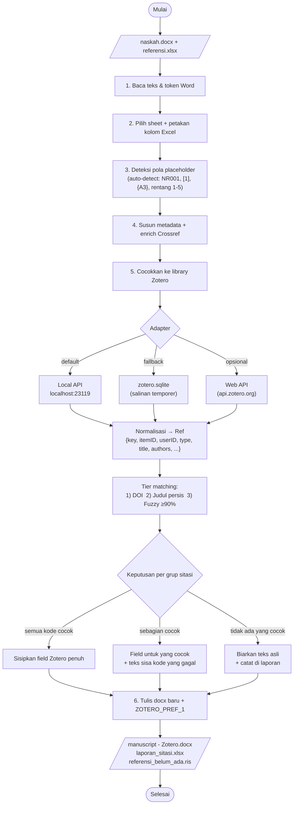

# Zotero Citation Automation — Flow Penggunaan

> Versi 0.1 — dirancang sebagai **kembaran** dari `C:\MENDELEY AUTOMATE`
> Pola: Word berisi placeholder (`NR007`, `[1-5]`) + Excel daftar referensi → output Word dengan field sitasi asli + laporan audit.

---

## 1. Apa yang Dilakukan Tool Ini

Sama persis dengan versi Mendeley, hanya target aplikasinya Zotero:

```
naskah.docx (placeholder)  +  referensi.xlsx
                ↓
        zotero_cite.py
                ↓
manuscript - Zotero.docx   →  tab Zotero di Word → Refresh → sitasi jadi
laporan_sitasi.xlsx        →  audit: mana yang berhasil / gagal
referensi_belum_ada.ris    →  drag ke Zotero untuk yang belum ada
```

Dokumen asli **tidak pernah ditimpa**.

**Bukan** tool untuk import/organize PDF. Fokusnya satu: mengubah kode sitasi teks menjadi **field sitasi Zotero yang hidup**, sekaligus mencatat auditnya.

---

## 2. Beda Mendeley vs Zotero (yang wajib diubah)

| Aspek | Versi Mendeley (sekarang) | Versi Zotero |
|---|---|---|
| Sumber library | SQLite `%APPDATA%\Mendeley Reference Manager\mrm\databases\*.db` | **Local API** `http://localhost:23119/api/` (utama) · SQLite `%USERPROFILE%\Zotero\zotero.sqlite` (cadangan) |
| ID item | UUID (`8f3a...`) | **itemKey** 8 karakter (`ABCD2345`) + `libraryID` |
| URI di dalam field | `http://www.mendeley.com/documents/?uuid=<uuid>` | `http://zotero.org/users/<userID>/items/<itemKey>` |
| Kode field | `ADDIN CSL_CITATION {json}` | `ADDIN ZOTERO_ITEM CSL_CITATION {json}` |
| `citationID` | tidak ada | **wajib**, 8 karakter acak per sitasi |
| Dokumen harus punya "prefs" | tidak | **ya** — properti `ZOTERO_PREF_1` di `docProps/custom.xml` |
| Field daftar pustaka | dibuat lewat Mendeley Cite | `ADDIN ZOTERO_BIBL {"uncited":[],"omitted":[],"custom":[]} CSL_BIBLIOGRAPHY` |
| Kunci DB saat app jalan | copy `.db` + `-wal` + `-shm` | API tidak menyentuh file; SQLite hanya dipakai kalau API mati |
| Nama file hasil | `manuscript - Mendeley.docx` | `manuscript - Zotero.docx` |

**Bagian yang bisa dipakai ulang hampir 100%:** deteksi pola placeholder, mapping kolom Excel, ekspansi rentang `[1-5]`, pengayaan Crossref, patch OpenXML, laporan Excel 4 sheet, generator RIS.

**Yang ditulis ulang:** lapisan library (Mendeley SQLite → Zotero adapter) dan pembangun payload field.

---

## 3. Flow Pengguna (5 Langkah, sama seperti versi Mendeley)

### Langkah 0 — Prasyarat & setup (sekali saja)

| Kebutuhan | Detail | Cara cek |
|---|---|---|
| Zotero 7 / 10+ | terpasang & sudah login | `C:\Program Files\Zotero\zotero.exe` |
| Plugin Word Zotero | tab **Zotero** muncul di Word | Word → tab Zotero ada |
| Local API aktif | Settings → Advanced → **"Allow other applications on this computer to communicate with Zotero"** | `curl http://localhost:23119/api/users/0/items?limit=1` → 200 |
| Library terisi | minimal beberapa entri | Zotero → My Library |
| Python 3.8+ | `lxml`, `pandas`, `openpyxl` | `pip install -r requirements.txt` |

> Kalau Local API tidak bisa diaktifkan (versi lama / kebijakan IT), tool otomatis jatuh ke mode `sqlite` — baca `zotero.sqlite` lewat salinan temporer, sama seperti trik yang dipakai di versi Mendeley.

### Langkah 1 — Siapkan file

1. Taruh **1 file `.docx`** berisi placeholder sitasi di folder repo.
2. Taruh **1 file `.xlsx`** berisi daftar referensi (kolom ID, Judul, DOI, Penulis, Tahun, Jurnal).
3. Nama file bebas — script memilih yang terbaru.

### Langkah 2 — Jalankan

- **Cara mudah:** double-click `Run.bat`
- **Cara terminal:** `python zotero_cite.py`

Keluaran console (mirror versi Mendeley):

```text
========================================================================
  WORD  ->  ZOTERO CITATION AUTOMATION (UNIVERSAL EDITION)
========================================================================
  Folder Kerja : C:\ZOTERO AUTOMATION
  Naskah Word  : naskah_penelitian.docx
  Data Excel   : data_referensi.xlsx
  Sumber Library: Zotero Local API (localhost:23119)

[1/6] Membaca naskah dokumen Word ...
[2/6] Menganalisis file Excel & mencocokkan kolom ...
[3/6] Mendeteksi pola placeholder sitasi di Word ...
[4/6] Menyusun metadata referensi + Crossref ...
[5/6] Mencocokkan dengan library Zotero ...
[6/6] Menyisipkan field Zotero & menulis dokumen baru ...

========================================================================
  HASIL EKSEKUSI:
  * 42 kelompok sitasi berhasil diubah menjadi field Zotero
  * 30 ID unik sukses terhubung ke library
  * 2 ID belum ada di Zotero : NR015, NR028

  Berkas Hasil Word   : manuscript - Zotero.docx
  Berkas Laporan Excel: laporan_sitasi.xlsx
  Berkas RIS          : referensi_belum_ada.ris
========================================================================
```

### Langkah 3 — Periksa laporan Excel

`laporan_sitasi.xlsx` — 4 sheet, identik dengan versi Mendeley:

| Sheet | Isi |
|---|---|
| **Ringkasan** | total sitasi, % berhasil, gagal-Zotero vs gagal-Excel, sumber library yang dipakai |
| **Detail Sitasi Word** | per kode: status, metode cocok (DOI / Judul Persis / Fuzzy 94%), itemKey, metadata, cuplikan kalimat |
| **Perlu Tindakan** | hanya yang gagal + instruksi perbaikan |
| **Excel Belum Digunakan** | referensi di Excel yang tidak pernah dikutip |

### Langkah 4 — Tindak lanjut yang gagal

- **`GAGAL: TIDAK ADA DI ZOTERO`** → drag `referensi_belum_ada.ris` ke jendela Zotero → jalankan `Run.bat` lagi → status jadi `BERHASIL`.
- **`GAGAL: TIDAK ADA DI EXCEL`** → kode dipakai di Word tapi barisnya belum ada di Excel. Tambahkan barisnya.

### Langkah 5 — Finalisasi di Word

1. Buka `manuscript - Zotero.docx`.
2. Tab **Zotero** → **Refresh** (sinkronkan semua sitasi ke gaya yang dipilih).
3. Letakkan kursor di akhir naskah → **Add/Edit Bibliography**.
4. Hapus daftar pustaka lama yang diketik manual.

> Berbeda dari Mendeley: di Zotero, langkah ini **wajib** karena tool hanya menulis payload mentah. Format tampilan akhir (APA/IEEE/Nature) ditentukan oleh CSL di sisi Zotero, bukan oleh script.

---

## 4. Alur Internal (Pipeline 6 Tahap)



---

## 5. Titik Teknis Kritis (dan Status Verifikasinya)

Ini bagian yang **berbeda** dari Mendeley dan wajib benar, kalau tidak Word akan menampilkan field rusak.

### 5.1 Bentuk field sitasi Zotero

```text
ADDIN ZOTERO_ITEM CSL_CITATION {"citationID":"a1b2C3d4","properties":{...},"citationItems":[...],"schema":"..."}
```

Struktur `citationItems`:

```json
{
  "id": 1234,
  "uris": ["http://zotero.org/users/12345/items/ABCD2345"],
  "itemData": {
    "id": 1234,
    "type": "article-journal",
    "title": "...",
    "container-title": "...",
    "volume": "12", "issue": "3", "page": "45-67",
    "DOI": "10.xxxx/yyyy",
    "author": [{"family": "Smith", "given": "John"}],
    "issued": {"date-parts": [["2023"]]}
  },
  "locator": "12"
}
```

Perbedaan penting vs Mendeley:
- Mendeley: `properties.mendeley.formattedCitation`
- Zotero: `properties.formattedCitation` + `properties.plainCitation` + `properties.noteIndex`
- Ada `citationID` unik per field (8 karakter alfanumerik).

### 5.2 `ZOTERO_PREF_1` — syarat dokumen dikenali Zotero

Zotero menandai sebuah dokumen sebagai "dokumen Zotero" lewat custom property di `docProps/custom.xml`:

```xml
<property name="ZOTERO_PREF_1" fmtid="{D5CDD505-2E9C-101B-9397-08002B2CF9AE}" pid="2">
  <vt:lpwstr>{"data":{...},"url":"http://zotero.org/users/12345/","prefs":{...}}</vt:lpwstr>
</property>
```

Tanpa properti ini, tombol **Refresh** di tab Zotero bisa menolak memproses dokumen. Versi Mendeley tidak butuh ini sama sekali, jadi ini **tambahan wajib**.

> **Status: perlu verifikasi empiris.** Format persisnya akan diambil dari dokumen contoh (lihat §6), bukan ditebak.

### 5.3 `id` numerik vs `itemKey`

Zotero menyimpan `id` = `items.itemID` (angka) di database. Local API **tidak** mengekspos `itemID`; yang tersedia hanya `key`.
Rencana: ambil `key → itemID` dari `zotero.sqlite` (baca saja), dan anggap `uris` sebagai penentu utama saat Zotero me-refresh.

> **Status: perlu verifikasi** — apakah Word tetap me-refresh dengan benar jika `id` dihilangkan dan hanya `uris` yang diisi.

### 5.4 URI untuk library yang belum pernah sinkron

Kemungkinan bentuk: `http://zotero.org/users/local/<libraryID>/items/<key>` untuk library lokal yang belum tersinkron ke zotero.org, dan `http://zotero.org/users/<userID>/items/<key>` untuk yang sudah sinkron.

> **Status: perlu verifikasi** — ini akan terlihat langsung dari dokumen contoh.

### 5.5 Jangan kunci field

Versi Mendeley memakai `w:fldLock="1"`. Untuk Zotero sebaiknya **tanpa lock**, karena Word perlu menghitung ulang field saat Refresh.

---

## 6. Fase 0 — Verifikasi Format (30 menit, sekali saja)

Sebelum menulis kode konversi, lakukan ini untuk mendapat **template asli**, bukan tebakan:

1. Install Zotero + plugin Word.
2. Buat `sampel.docx` kosong, ketik satu kalimat.
3. Sisipkan **1 sitasi asli** lewat tab Zotero.
4. Sisipkan **bibliography** lewat tab Zotero.
5. Simpan, lalu:

```powershell
Copy-Item sampel.docx sampel.zip
Expand-Archive sampel.zip -DestinationPath sampel_x
```

6. Periksa:
   - `sampel_x\word\document.xml` → ambil bentuk persis `instrText` + run pembungkusnya
   - `sampel_x\docProps\custom.xml` → ambil `ZOTERO_PREF_1` dan URI/userID
7. Simpan hasilnya sebagai:
   - `templates/field_citation.json` → kerangka payload
   - `templates/zotero_prefs.json` → isi custom property
   - `templates/field_bibl.json`

Setelah ini, pembangun field cukup mengisi template — tidak ada lagi tebakan.

**Output Fase 0:** 3 file template + catatan `userID`/`libraryID` mesin target.

---

## 7. Struktur Proyek (kembar dari repo Mendeley)

```text
C:\ZOTERO AUTOMATION\
├── zotero_cite.py           # pipeline utama (turunan mendeley_cite.py)
├── zotero_library.py        # adapter library: localapi | sqlite | webapi
├── zotero_field.py          # pembangun field + ZOTERO_PREF_1
├── Run.bat                  # launcher 1-klik
├── config.json              # folder, docx, workbook, style, adapter
├── requirements.txt         # lxml, pandas, openpyxl, requests
├── WordMacro.bas            # macro Word (jalankan dari dokumen aktif)
├── templates/
│   ├── field_citation.json
│   ├── field_bibl.json
│   └── zotero_prefs.json
├── crossref_cache.json      # cache Crossref
└── README.md
```

Pemisahan `zotero_library.py` inilah yang membuat "fleksibel dulu" bisa diwujudkan: ganti adapter tanpa menyentuh pipeline.

```python
# kontrak adapter
class ZoteroAdapter:
    def ping(self) -> bool: ...
    def library(self) -> list[Ref]: ...      # semua item, ternormalisasi
    def user_id(self) -> str: ...
```

| Adapter | Kapan dipakai | Auth |
|---|---|---|
| `localapi` **(default)** | Zotero jalan, Local API aktif | tidak perlu |
| `sqlite` | Zotero mati / Local API diblokir | tidak perlu (baca salinan DB) |
| `webapi` | butuh data group lintas mesin | API key |

---

## 8. Config & CLI

`config.json`:

```json
{
  "folder": "C:\\ZOTERO AUTOMATION",
  "docx": "",
  "workbook": "",
  "style": "author-year",
  "enrich": true,
  "adapter": "localapi",
  "zotero_data_dir": "",
  "user_id": "",
  "output_name": "manuscript - Zotero.docx"
}
```

Argumen CLI (sama dengan versi Mendeley, ditambah opsi Zotero):

| Opsi | Keterangan |
|---|---|
| `--folder`, `--docx`, `--workbook`, `--out` | sama seperti versi Mendeley |
| `--style author-year\|numeric` | gaya tampilan sementara |
| `--id-regex`, `--id-column`, `--sheet` | paksa pola / kolom / sheet |
| `--no-enrich` | matikan Crossref |
| `--dry-run` | analisis saja, tanpa menulis file |
| `--adapter localapi\|sqlite\|webapi` | pilih sumber library |
| `--zotero-dir "D:\Zotero"` | kalau data dir Zotero tidak default |
| `--user-id 12345` | untuk URI field |
| `--make-bibl` | sekalian menulis field bibliography di akhir dokumen |

---

## 9. Troubleshooting

| Gejala | Penyebab | Solusi |
|---|---|---|
| `403` dari `localhost:23119` | Local API belum diaktifkan | Settings → Advanced → centang izin komunikasi |
| `Connection refused` | Zotero tidak berjalan | buka Zotero, atau pakai `--adapter sqlite` |
| Sitasi jadi teks abu-abu, Refresh tidak mengubah | `ZOTERO_PREF_1` tidak ada / userID salah | cek `docProps/custom.xml`, jalankan ulang dengan `--user-id` benar |
| Tab Zotero bilang "dokumen ini bukan dokumen Zotero" | prefs tidak terdeteksi | buka `sampel.docx` dari §6, bandingkan prefs |
| Semua berstatus "tidak ada di Zotero" | adapter membaca library kosong | cek `library()` mengembalikan > 0 item |
| Item ada di Zotero tapi tidak cocok | DOI kosong di Zotero + judul beda tipis | turunkan ambang fuzzy lewat config, atau lengkapi DOI |
| Word rusak / tidak bisa dibuka | XML tidak valid | tool selalu menulis ke file baru; buka file asli, laporkan grup yang gagal |
| Database is locked (mode sqlite) | Zotero memegang lock | tutup Zotero, atau kembali ke `localapi` |

---

## 10. Urutan Pengerjaan

**Fase 0 — Verifikasi (½ hari)**
- [ ] Jalankan §6, kumpulkan 3 template
- [ ] Catat `userID`, bentuk URI, ada/tidaknya `itemID`

**Fase 1 — Port inti (1–2 hari)**
- [ ] Copy `mendeley_cite.py` → `zotero_cite.py`
- [ ] Ganti `build_field_json()` + `build_csl_item()` sesuai template
- [ ] Ganti `find_mrm_db()`/`load_library()` → `zotero_library.py`
- [ ] Tambah injeksi `ZOTERO_PREF_1`

**Fase 2 — Parity output (1 hari)**
- [ ] `laporan_sitasi.xlsx` 4 sheet (ganti label "Mendeley" → "Zotero")
- [ ] `referensi_belum_ada.ris` (RIS bisa langsung diimpor Zotero)
- [ ] `Run.bat`, `WordMacro.bas`, `config.json`

**Fase 3 — Pengujian (1 hari)**
- [ ] 20 referensi uji: ada semua / sebagian / duplikat judul
- [ ] Uji Word 2019 & 365
- [ ] Uji library belum sinkron vs sudah sinkron
- [ ] Uji mode `sqlite` saat Zotero ditutup

**Fase 4 — Opsional**
- [ ] `--make-bibl` untuk menulis field bibliography otomatis
- [ ] Adapter `webapi` untuk library group
- [ ] GUI review sederhana

---

## 11. Yang Masih Perlu Diputuskan

1. **Target Word**: 2019, 365, atau keduanya? (mempengaruhi cara uji field)
2. **Library group**: perlu dukung grup Zotero, atau hanya *My Library*?
3. **Daftar pustaka**: dibuat otomatis oleh tool (`--make-bibl`) atau tetap manual lewat tab Zotero?
4. **Nama file hasil**: ikuti pola Mendeley (`manuscript - Zotero.docx`) atau nama asli + suffix?

---

## 12. Catatan Implementasi (v0.1 — sudah jalan)

Fase 0–3 sudah dieksekusi. Self-test end-to-end **41/41 lulus** tanpa Zotero terpasang
(adapter `fixture`).

| Fase | Hasil |
|---|---|
| Fase 1 — port inti | `zotero_cite.py`, `zotero_field.py`, `zotero_library.py` selesai |
| Fase 2 — parity output | docx + laporan 4 sheet + RIS + CSV + `PERLU_DIPERIKSA.txt` |
| Fase 3 — pengujian | sampel Word/Excel/library fixture, verifikasi field & prefs |
| Fase 0 — verifikasi | **tertunda**: butuh Zotero terpasang (lihat §6) |

### Bug yang ditemukan saat porting

Regex pemisah pada `_make_pattern()` tidak dibungkus grup:

```python
sep = r"\s*[,;&]\s*|\s+and\s+|\s+dan\s+"        # versi Mendeley
sep = r"(?:\s*[,;&]\s*|\s+and\s+|\s+dan\s+)"    # perbaikan
```

Tanpa pembungkus, `(NR001; NR002)` tidak dikenali sebagai satu kelompok dan dipecah menjadi
dua field terpisah. **Bug ini juga ada di `mendeley_cite.py`** dan perlu di-backport.

### Sisa risiko

1. Format persis `ZOTERO_PREF_1` masih kandidat → kalibrasi §6.
2. Bentuk URI `users/<id>` vs `users/local/<libraryID>` → `--uri-mode`.
3. Kebutuhan `itemID` numerik saat Refresh → adapter `sqlite` menyediakannya; adapter `localapi`
   memakai ID deterministik sebagai cadangan.
